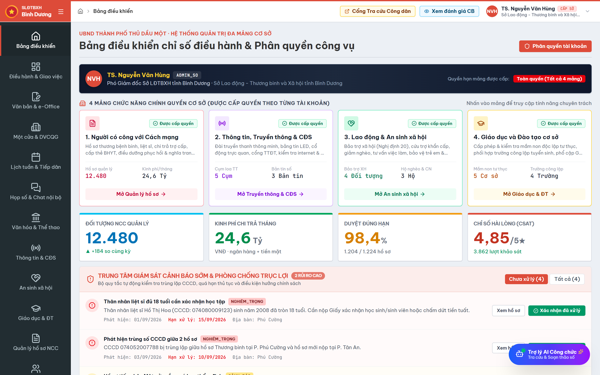
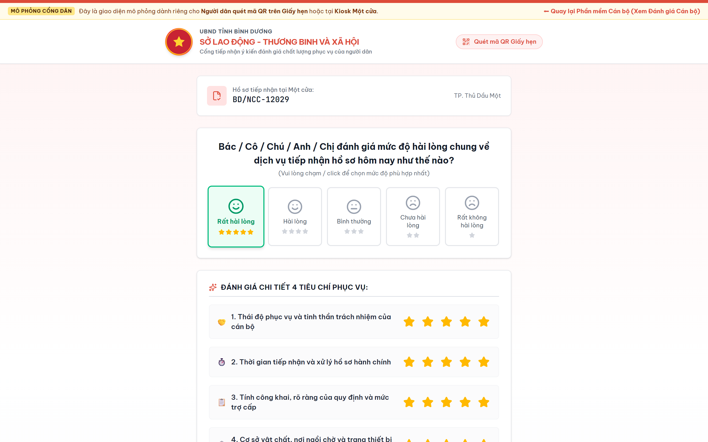
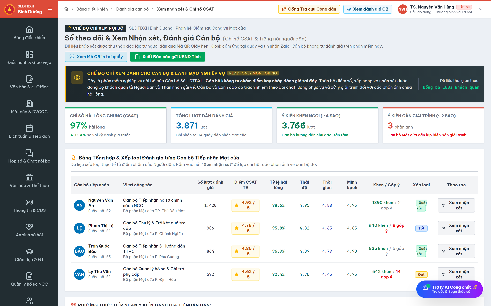
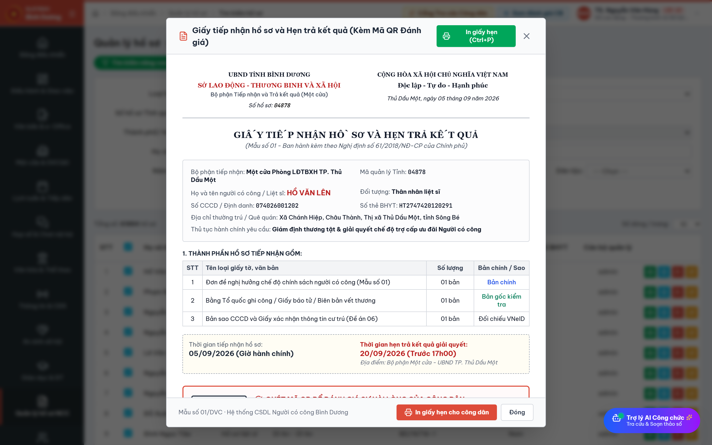
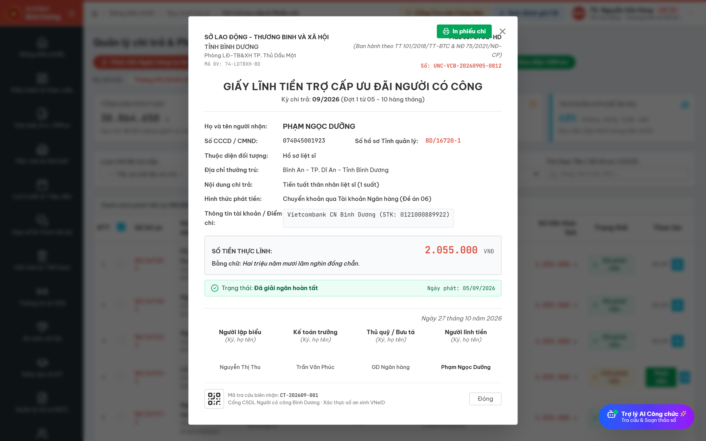
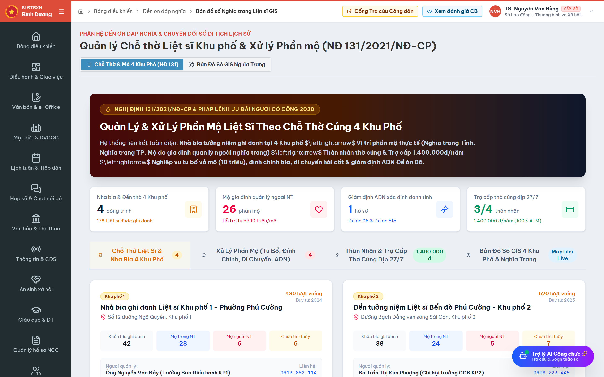
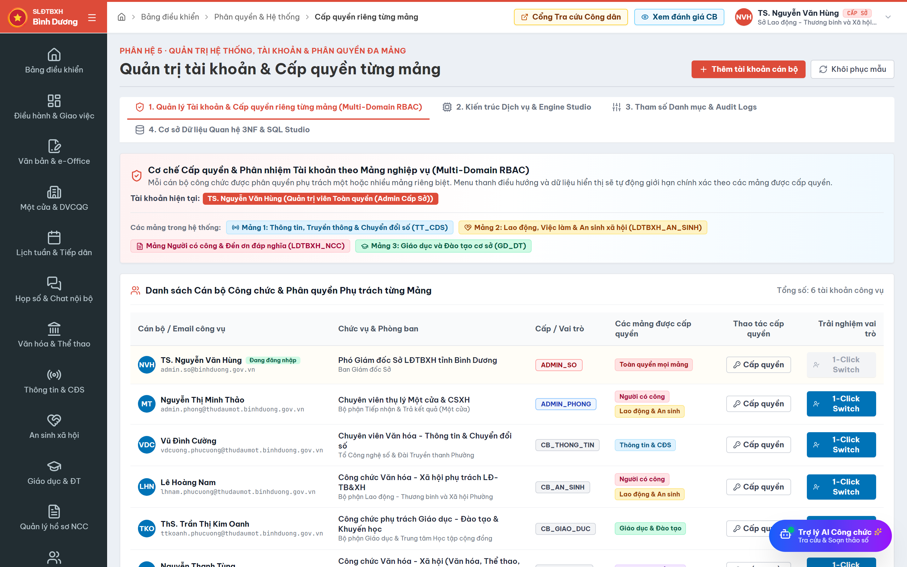

# 🏛️ HỆ THỐNG QUẢN LÝ NGHIỆP VỤ CHUYÊN MÔN & ĐÁNH GIÁ DỊCH VỤ CÔNG CẤP XÃ/PHƯỜNG
### Ủy ban nhân dân Phường Phú Cường / Phòng LĐTBXH TP. Thủ Dầu Một · Sở LĐTBXH tỉnh Bình Dương

[](https://github.com/Awac8989/BCTT)
[](https://react.dev)
[](https://tanstack.com/router)
[](https://tailwindcss.com)
[](https://www.typescriptlang.org)
[](https://vitejs.dev)
[](#-kiểm-thử-tự-động-backend-222-test-cases)
[](#-kiến-trúc-cơ-sở-dữ-liệu-quan-hệ-3nf-42-bảng)
[](#-hướng-dẫn-triển-khai-lên-vercel-deployment-guide)

---

## 📖 GIỚI THIỆU TỔNG QUAN HỆ THỐNG

**Hệ thống Quản lý Nghiệp vụ Chuyên môn & Đánh giá Dịch vụ công Cấp Xã/Phường (Phiên bản 2.5 Enterprise)** là nền tảng chuyển đổi số toàn diện được nghiên cứu, thiết kế và phát triển bài bản nhằm hiện đại hóa toàn bộ hoạt động chỉ đạo điều hành, quản trị công vụ và giải quyết thủ tục hành chính cho chính quyền cơ sở (UBND Phường Phú Cường, TP. Thủ Dầu Một, tỉnh Bình Dương).

Hệ thống tích hợp liền mạch giữa **15 phân hệ chuyên môn sâu rộng**, tuân thủ 100% hệ thống văn bản quy phạm pháp luật hiện hành của Nhà nước:
- **Quản lý Hồ sơ Người có công & Chi trả trợ cấp:** Pháp lệnh 02/2020/UBTVQH14, Nghị định 131/2021/NĐ-CP, Nghị định 75/2021/NĐ-CP.
- **Cơ chế Một cửa & Dịch vụ công trực tuyến:** Nghị định 61/2018/NĐ-CP, Nghị định 107/2021/NĐ-CP, Quyết định 766/QĐ-TTg.
- **Văn phòng Điện tử & Thể thức văn bản hành chính:** Nghị định 30/2020/NĐ-CP, Trục liên thông văn bản quốc gia VDXP.
- **Lao động, An sinh xã hội & Giảm nghèo đa chiều:** Nghị định 20/2021/NĐ-CP, Quyết định 24/2021/QĐ-TTg, Thông tư 01/2022/TT-BLĐTBXH, Luật Trẻ em 2016, Nghị định 116/2021/NĐ-CP.
- **Giáo dục & Đào tạo cơ sở:** Thông tư 49/2021/TT-BGDĐT, Nghị định 20/2014/NĐ-CP, Thông tư 07/2016/TT-BGDĐT, Thông tư 44/2014/TT-BGDĐT, Quyết định 1246/QĐ-BYT.
- **Văn hóa, Gia đình, Thể thao & Du lịch:** Nghị định 86/2023/NĐ-CP, Quyết định 04/2022/QĐ-TTg, Chỉ thị 814/TTg, Nghị định 109/2015/NĐ-CP, Nghị định 36/2019/NĐ-CP & Thông tư 04/2018/TT-BVHTTDL.
- **Thông tin, Truyền thông & Chuyển đổi số:** Nghị định 42/2022/NĐ-CP, Bộ chỉ số DTI cấp xã, Chỉ thị 14/CT-TTg & QĐ 830/QĐ-TTg (Lực lượng 35 tác chiến không gian mạng cơ sở).
- **Đánh giá KPI & Thi đua công vụ:** Nghị định 90/2020/NĐ-CP & Nghị định 48/2023/NĐ-CP, Quyết định 06/QĐ-TTg (Đề án 06).

---

## 🎨 THIẾT KẾ UX/UI CHUẨN MỰC CHÍNH QUYỀN SỐ (UI/UX DESIGN SYSTEM & ARCHITECTURE)

Một trong những ưu điểm nổi trội nhất của hệ thống là **Trải nghiệm Người dùng (UX)** và **Giao diện Người dùng (UI)** được thiết kế chuyên biệt, đạt đến độ hoàn mỹ theo chuẩn mực quốc tế kết hợp cùng bản sắc công quyền Việt Nam.

```
+-------------------------------------------------------------------------------------------------------+
|                                  KIẾN TRÚC THIẾT KẾ UX/UI CÔNG QUYỀN SỐ                               |
+-------------------------------------------------------------------------------------------------------+
|  🏛️ SẮC THÁI CÔNG QUYỀN       |  📊 TRỰC QUAN HÓA CAO CẤP        |  📄 CHUẨN HÓA IN ẤN HÀNH CHÍNH    |
|  - Sovereign Red (#dd4b39)    |  - Recharts Radar CSAT (SIPAS)   |  - Giấy hẹn Mẫu 01 (NĐ 61 QR)     |
|  - Heritage Navy (#1a202c)    |  - Heatmap 14 Phường 3 dải màu   |  - Phiếu chi C70a-HD có Barcode   |
|  - Golden Emblem Accents      |  - Bản đồ số GIS Mộ Liệt sĩ      |  - Giấy chứng nhận Mẫu 03 (TT 01) |
|  - Chuẩn WCAG 2.1 AA sắc nét  |  - Dashboard DTI & KPI Realtime  |  - In ấn A4 Pixel-Perfect CSS     |
|-------------------------------+----------------------------------+-----------------------------------|
|  📱 TRẢI NGHIỆM ĐA NỀN TẢNG   |  ⚡ TƯƠNG TÁC VI MÔ THÔNG MINH   |  🔐 PHÂN QUYỀN TRẢI NGHIỆM RBAC   |
|  - Desktop Cán bộ (1080p+)    |  - Toasts Sonner thông minh      |  - Multi-Domain Navigation Menu   |
|  - Kiosk Cảm ứng Một cửa      |  - Optimistic State Updates      |  - Breadcrumbs quy trình 6 bước   |
|  - Mobile Web Công dân QR     |  - Dialogs xác thực ký số        |  - Giới hạn quyền hiển thị data   |
+-------------------------------------------------------------------------------------------------------+
```

### 1. Triết Lý Thiết Kế Trực Quan & Nhận Diện Thương Hiệu Công Quyền
- **Sắc Đỏ Công Quyền (`#dd4b39` / `#c23321`):** Sử dụng làm màu chủ đạo (Primary Brand), gợi nhớ màu cờ Tổ quốc, Quốc huy Việt Nam và dấu mộc đỏ hành chính nhà nước. Sắc đỏ được cân bằng tinh tế với nền trắng ngọc trai (`#f8fafc`) và viền xám titan (`#e2e8f0`), mang lại cảm giác trang nghiêm nhưng hiện đại.
- **Phân Tầng Màu Sắc Theo 4 Khối Chuyên Môn:**
  * 🔴 **Khối Người có công & Đền ơn đáp nghĩa (`rose`/`red`):** Biểu tượng hoa sen và ngọn lửa tri ân.
  * 🟡 **Khối Lao động, Việc làm & An sinh xã hội (`amber`/`orange`):** Biểu tượng bàn tay đùm bọc, nâng đỡ người yếu thế.
  * 🟢 **Khối Giáo dục & Đào tạo cơ sở (`emerald`/`green`):** Biểu tượng mầm non tri thức, trường lớp và sự phát triển tương lai.
  * 🔵 **Khối Thông tin, Truyền thông & Chuyển đổi số (`sky`/`blue`):** Biểu tượng sóng phát thanh, vệ tinh và chính quyền số.
- **Typography Chuẩn Thể Thức Hành Chính:** Sử dụng phông chữ không chân hiện đại (*Inter / Roboto*), phân định cấp bậc rõ ràng (H1 tiêu đề lớn đậm nét, nhãn tiêu chí chữ hoa nhỏ tinh tế, số liệu tài chính định dạng font monospaced dễ dò tìm sai sót).

### 2. Thiết Kế Trực Quan Hóa Số Liệu Đỉnh Cao (Data Visualization)
Hệ thống loại bỏ hoàn toàn các bảng số thô cứng, thay thế bằng các widget đồ họa tương tác cao:
- **Biểu Đồ Radar 4 Trụ Cột SIPAS (`Recharts Radar`):** Thể hiện trực quan 4 tiêu chí đánh giá mức độ hài lòng của nhân dân (Thái độ phục vụ, Thời gian thụ lý, Tính công khai minh bạch, Cơ sở hạ tầng).
- **Bản Đồ Nhiệt 14 Phường Phân Tầng Ngân Sách:**
  * 🟢 **Xanh Lá Emerald (`#00a65a`):** Ngân sách cao ($\ge 2.5$ tỷ VNĐ/tháng).
  * 🩵 **Xanh Ngọc Cyan (`#00c0ef`):** Ngân sách trung bình ($1.5 - 2.5$ tỷ VNĐ/tháng).
  * 🔵 **Xanh Lam Royal Blue (`#3c8dbc`):** Ngân sách dưới $1.5$ tỷ VNĐ/tháng.
- **Biểu Đồ Donut & Progress Bar:** Thể hiện tiến độ hoàn thành chỉ tiêu DTI, tỷ lệ giải quyết hồ sơ đúng hạn SLA 24h, và cơ cấu gia đình văn hóa.

### 3. Bản Đồ Số Không Gian Địa Lý (Interactive GIS Map)
- Tích hợp công nghệ bản đồ tương tác tại phân hệ **Nghĩa trang Liệt sĩ (`/nghia-trang`)**:
  * Chia lưới phân lô tọa độ trực quan 4 phân khu **Khu A, Khu B, Khu C, Khu D**.
  * Nhấp chuột vào từng ngôi mộ để xem: Họ tên liệt sĩ, năm sinh, ngày hy sinh, đơn vị chiến đấu, vị trí an táng, tình trạng bia mộ.
  * **Trải nghiệm Dâng Hoa & Thắp Nén Hương Tri Ân 3D:** Hiệu ứng hạt khói hương nghi ngút và vòng hoa kính cẩn, giúp đồng bào cả nước viếng thăm liệt sĩ từ xa.

### 4. Tách Bạch Kênh Đánh Giá CSAT Dành Riêng Cho Người Dân
- Giao diện khảo sát (`/khao-sat`) được thiết kế theo chuẩn Kiosk công cộng và Mobile Web:
  * Không có thanh điều hướng menu của cán bộ, tránh làm xao nhãng người dân.
  * Nút bấm biểu tượng cảm xúc (Emoji 1-5 sao) kích thước lớn, tương phản cao, chạm nhẹ là phản hồi tức thì.
  * Tích hợp thuật toán **AI Sentiment Analysis (NLP)** tự động phân loại ý kiến góp ý của người dân thành **Tích Cực (Positive)**, **Trung Lập (Neutral)**, hoặc **Tiêu Cực (Negative)** để cảnh báo cho Ban Giám đốc Sở.

### 5. Chuẩn Hóa In Ấn Hành Chính (Print-Ready CSS Engine)
- Hệ thống xây dựng lớp CSS `@media print` đạt chuẩn thể thức văn bản **Nghị định 30/2020/NĐ-CP**:
  * Khi nhấn nút **In văn bản**, toàn bộ thanh menu điều hướng, nút bấm, header website tự động ẩn.
  * Căn lề chuẩn A4 (Trên 20-25mm, Dưới 20-25mm, Trái 30-35mm, Phải 15-20mm).
  * Xuất bản sắc nét: **Giấy hẹn Mẫu 01 tích hợp Mã QR Code lớn**, **Phiếu chi C70a-HD có Barcode Code 128**, **Giấy chứng nhận khuyết tật Mẫu 03**, và **Biên bản kiểm tra ATTP bán trú**.

---

## 🏛️ DANH MỤC 15 PHÂN HỆ NGHIỆP VỤ CỐT LÕI

| STT | Tuyến Đường (Route) | Tên Phân Hệ Nghiệp Vụ | Căn Cứ Pháp Lý & Đặc Điểm Cốt Lõi |
| :---: | :--- | :--- | :--- |
| **01** | `/dieu-hanh` | **Trung tâm Điều hành Lãnh đạo & Check-in KPI** | Giám sát KPI các khối công chức, thẩm định phê chuẩn sản phẩm check-in, giao việc số hóa và giao ban công vụ. |
| **02** | `/van-ban` | **Văn phòng Điện tử & e-Office** | Quản lý Văn bản Đến, Văn bản Đi theo [Nghị định 30/2020/NĐ-CP](file:///q:/CODE_visual/filebctt/src/routes/van-ban.tsx), tích hợp Trục VDXP và ký số SmartCA. |
| **03** | `/mot-cua` | **Cơ chế Một cửa Quốc gia & DVC** | Giải quyết TTHC cấp xã theo [Nghị định 61/2018/NĐ-CP](file:///q:/CODE_visual/filebctt/src/routes/mot-cua.tsx) và [Nghị định 107/2021/NĐ-CP](file:///q:/CODE_visual/filebctt/src/routes/mot-cua.tsx), xuất 4 mẫu biểu chuẩn. |
| **04** | `/lich-tuan` | **Lịch tuần Lãnh đạo & Sổ Tiếp công dân** | Lịch công tác tuần của Thường trực Đảng ủy - HĐND - UBND, Sổ nhật ký tiếp công dân định kỳ và xử lý đơn thư khiếu nại tố cáo. |
| **05** | `/hop-truc-tuyen` | **Họp Trực tuyến & Chat Nội bộ Mã hóa** | Phòng họp số e-Cabinet cơ sở, chia sẻ tài liệu số, trao đổi công vụ tức thời giữa các khối công chức. |
| **06** | `/van-hoa-xa-hoi` | **Văn hóa, Gia đình, Di sản & Thể thao** | Xét duyệt Gia đình VH [Nghị định 86/2023/NĐ-CP](file:///q:/CODE_visual/filebctt/src/routes/van-hoa-xa-hoi.tsx), Tiêu chí Khu phố VH, Kiểm tra Đội 814, Đô thị văn minh [Quyết định 04/2022/QĐ-TTg](file:///q:/CODE_visual/filebctt/src/routes/van-hoa-xa-hoi.tsx), Nghệ nhân Di sản [Nghị định 109/2015/NĐ-CP](file:///q:/CODE_visual/filebctt/src/routes/van-hoa-xa-hoi.tsx), Cơ sở thể thao & Bể bơi phòng đuối nước [Nghị định 36/2019/NĐ-CP](file:///q:/CODE_visual/filebctt/src/routes/van-hoa-xa-hoi.tsx) & [Thông tư 04/2018/TT-BVHTTDL](file:///q:/CODE_visual/filebctt/src/routes/van-hoa-xa-hoi.tsx). |
| **07** | `/thong-tin-truyen-thong`| **Thông tin, Truyền thông & Chuyển đổi số** | Tiếp nhận phản ánh hiện trường 1022 (SLA 24h), Đánh giá chỉ số DTI cấp xã, Cổng TTĐT Phường & Zalo OA Broadcast [Nghị định 42/2022/NĐ-CP](file:///q:/CODE_visual/filebctt/src/routes/thong-tin-truyen-thong.tsx), Giám sát an ninh mạng Lực lượng 35 [Chỉ thị 14/CT-TTg](file:///q:/CODE_visual/filebctt/src/routes/thong-tin-truyen-thong.tsx). |
| **08** | `/an-sinh-xa-hoi` | **Lao động, Việc làm & An sinh Xã hội** | Trợ cấp BTXH [Nghị định 20/2021/NĐ-CP](file:///q:/CODE_visual/filebctt/src/routes/an-sinh-xa-hoi.tsx), Rà soát hộ nghèo đa chiều [Quyết định 24/2021/QĐ-TTg](file:///q:/CODE_visual/filebctt/src/routes/an-sinh-xa-hoi.tsx), Cung cầu lao động quân nhân xuất ngũ [Thông tư 01/2022/TT-BLĐTBXH](file:///q:/CODE_visual/filebctt/src/routes/an-sinh-xa-hoi.tsx), Bảo vệ trẻ em Luật Trẻ em 2016, Trợ cấp Thờ cúng Liệt sĩ Mẫu 04 [Nghị định 131/2021/NĐ-CP](file:///q:/CODE_visual/filebctt/src/routes/an-sinh-xa-hoi.tsx), Hội đồng khuyết tật [Thông tư 01/2019/TT-BLĐTBXH](file:///q:/CODE_visual/filebctt/src/routes/an-sinh-xa-hoi.tsx), Quỹ Đền ơn đáp nghĩa [Nghị định 45/2017/NĐ-CP](file:///q:/CODE_visual/filebctt/src/routes/an-sinh-xa-hoi.tsx), Nhà Tình nghĩa. |
| **09** | `/giao-duc-dao-tao` | **Giáo dục & Đào tạo cơ sở** | Quản lý Mầm non tư thục [Thông tư 49/2021/TT-BGDĐT](file:///q:/CODE_visual/filebctt/src/routes/giao-duc-dao-tao.tsx), Mạng lưới trường học công lập, Phổ cập GD-XMC [Nghị định 20/2014/NĐ-CP](file:///q:/CODE_visual/filebctt/src/routes/giao-duc-dao-tao.tsx) & [Thông tư 07/2016/TT-BGDĐT](file:///q:/CODE_visual/filebctt/src/routes/giao-duc-dao-tao.tsx), Đánh giá Cộng đồng học tập [Thông tư 44/2014/TT-BGDĐT](file:///q:/CODE_visual/filebctt/src/routes/giao-duc-dao-tao.tsx), Kiểm thực 3 bước ATTP bán trú [Quyết định 1246/QĐ-BYT](file:///q:/CODE_visual/filebctt/src/routes/giao-duc-dao-tao.tsx). |
| **10** | `/ho-so`, `/tham-dinh` | **Quản lý Hồ sơ Người có công** | Vòng đời thụ lý hồ sơ 6 bước, tính toán trợ cấp tự động theo [Nghị định 75/2021/NĐ-CP](file:///q:/CODE_visual/filebctt/src/routes/ho-so.tsx), thẩm định số hóa và ký số điện tử SmartCA. |
| **11** | `/chi-tra` | **Chi trả Trợ cấp & Đối soát Ngân hàng** | Lập danh sách chi trả ATM & Bưu điện, xuất phiếu chi Mẫu C70a-HD có barcode, khớp lệnh sao kê ngân hàng tự động. |
| **12** | `/dieu-duong`, `/dung-cu-chinh-hinh` | **Điều dưỡng & Dụng cụ Chỉnh hình** | Quản lý kế hoạch điều dưỡng tập trung (1.8x) & tại nhà (0.9x), theo dõi niên hạn 3-5 năm phương tiện chỉnh hình xe lăn, chân tay giả. |
| **13** | `/nghia-trang` | **Bản đồ số Nghĩa trang Liệt sĩ GIS** | Số hóa sơ đồ phân lô Khu A, B, C, D; định vị phần mộ liệt sĩ; dâng hoa và thắp hương trực tuyến. |
| **14** | `/danh-gia`, `/khao-sat` | **Khảo sát CSAT & Đo lường SIPAS** | Kênh đánh giá độc lập cho người dân qua QR Code/Kiosk; Radar Chart SIPAS và bảng xếp hạng 14 phường cho cán bộ. |
| **15** | `/he-thong` | **Phân quyền Đa Mảng & SQL Studio 3NF** | Quản trị RBAC, cấu hình mức chuẩn, Kiểm thử Engine Studio và Duyệt Cơ sở Dữ liệu 42 bảng quan hệ. |

---

## 📸 BỘ SƯU TẬP HÌNH ẢNH GIAO DIỆN THỰC TẾ (VISUAL SHOWCASE)

### 1. Trung Tâm Điều Hành Lãnh Đạo & Check-in Sản Phẩm KPI (`/dieu-hanh`)
Bảng điều khiển tối cao dành cho Thường trực Đảng ủy và Lãnh đạo UBND Phường: giám sát trực tiếp tiến độ hoàn thành chỉ tiêu của 4 khối chuyên môn, phê duyệt kết quả check-in và ký số điện tử.

<p align="center">
  
</p>

---

### 2. Phân Hệ Đánh Giá CSAT & Kiosk Cảm Ứng Công Dân (`/khao-sat` & `/danh-gia`)
Giao diện công dân được tối giản tối đa với chữ lớn, nút bấm cảm ứng trực quan 5 sao, kết nối thời gian thực với Màn hình Giám sát Radar 4 trụ cột SIPAS của Lãnh đạo.

<p align="center">
  
  
</p>

---

### 3. Xuất Biểu Mẫu Hành Chính Chuẩn Có Mã QR Code & Barcode
Tự động xuất in pixel-perfect Giấy tiếp nhận hồ sơ và Hẹn trả kết quả (Mẫu 01 - NĐ 61/2018) và Phiếu chi trả trợ cấp C70a-HD có mã vạch xác thực.

<p align="center">
  
  
</p>

---

### 4. Bản Đồ Số Nghĩa Trang Liệt Sĩ GIS & Dâng Hương Online (`/nghia-trang`)
Bản đồ phân lô tương tác Khu A, B, C, D với tọa độ địa lý, kết hợp nghi thức dâng hoa và thắp nén hương tưởng niệm liệt sĩ trực tuyến.

<p align="center">
  
</p>

---

### 5. Cơ Sở Dữ Liệu Quan Hệ 3NF & SQL Studio Console (`/he-thong`)
Bộ duyệt 42 bảng 3NF với Metadata cột, khóa chính 🔑, khóa ngoại, bộ lọc phân hệ, bàn điều khiển SQL Console trực tiếp và xuất file SQL Dump 1-click.

<p align="center">
  
</p>

---

## 🗄️ KIẾN TRÚC CƠ SỞ DỮ LIỆU QUAN HỆ 3NF (42 BẢNG)

Hệ thống được thiết kế theo chuẩn hóa dữ liệu dạng chuẩn 3 (3NF), InnoDB engine, hỗ trợ đầy đủ giao dịch ACID (`beginTransaction`, `commit`, `rollback`) và lưu trữ bền vững:

```
+---------------------------------------------------------------------------------------------------------+
|                                42 BẢNG QUAN HỆ 3NF & CÁC PHÂN HỆ NGHIỆP VỤ                              |
+---------------------------------------------------------------------------------------------------------+
| 1. HỆ THỐNG & DANH MỤC DÙNG CHUNG                                                                      |
|    - dm_phuong (14 Phường TDM)           - dm_loai_doi_tuong (Danh mục NCC)                            |
|    - sys_roles (RBAC phân quyền)         - sys_users (Tài khoản & phân quyền mảng)                     |
|                                                                                                         |
| 2. CHÍNH SÁCH NGƯỜI CÓ CÔNG, ĐIỀU DƯỠNG & NGHĨA TRANG LIỆT SĨ (NĐ 131/2021 & NĐ 75/2021)                |
|    - ho_so_ncc (Bảng trung tâm)          - ho_so_liet_sy (Trích lục hy sinh)                           |
|    - than_nhan_liet_si (Thờ cúng)        - ke_hoach_dieu_duong (Định mức 1.8 & 0.9)                    |
|    - lich_su_chi_tra (C70a-HD)           - ho_so_bao_giam_mai_tang (Mẫu 02)                            |
|    - danh_sach_phuong_tien_chinh_hinh    - nghia_trang_mo_liet_si (Số hóa GIS)                         |
|    - khao_sat_danh_gia (CSAT & Sentiment)- doi_soat_chi_tra_ngan_hang (Đề án 06)                      |
|                                                                                                         |
| 3. GIÁO DỤC VÀ ĐÀO TẠO CƠ SỞ (TT 49/2021, NĐ 20/2014 & TT 44/2014)                                      |
|    - ho_so_tthc_giao_duc (DVC Một cửa)   - co_so_mam_non_tu_thuc (Nhóm trẻ ngoài CL)                   |
|    - truong_hoc_cong_lap                 - dieu_tra_pho_cap_gd (PCGD mức 3 & XMC)                      |
|    - danh_gia_cong_dong_hoc_tap          - tieu_chi_cong_dong_hoc_tap (100 điểm)                       |
|    - nhat_ky_kiem_thuc_attp (Kiểm thực 3 bước bán trú QĐ 1246/QĐ-BYT)                                  |
|                                                                                                         |
| 4. LAO ĐỘNG, VIỆC LÀM, BẢO TRỢ XÃ HỘI & QUỸ ĐỀN ƠN ĐÁP NGHĨA                                           |
|    - ho_so_bao_tro_xa_hoi (NĐ 20/2021)   - ho_ngheo_can_ngheo (Phiếu B1/B2 QĐ 24)                      |
|    - cung_cau_lao_dong (TT 01/2022)      - tre_em_hoan_canh_dac_biet (Luật Trẻ em)                     |
|    - ho_so_tho_cung_liet_si (Mẫu 04)     - hoi_dong_xac_dinh_khuyet_tat (TT 01/2019)                   |
|    - so_quy_den_on_dap_nghia (NĐ 45)     - nha_tinh_nghia_nguoi_co_cong (80tr / 40tr)                  |
|                                                                                                         |
| 5. VĂN HÓA, GIA ĐÌNH, DI SẢN & THỂ THAO                                                                |
|    - ho_so_gia_dinh_van_hoa (NĐ 86/2023) - khu_pho_van_hoa                                            |
|    - nghe_nhan_di_san_van_hoa (NĐ 109)   - co_so_the_thao_ho_boi (Cứu hộ phòng đuối nước)              |
|                                                                                                         |
| 6. THÔNG TIN, TRUYỀN THÔNG, CHUYỂN ĐỔI SỐ & ĐÁNH GIÁ CÁN BỘ                                            |
|    - phan_anh_hien_truong_1022 (SLA 24h) - bo_chi_so_dti_cap_xa (DTI cấp Phường)                       |
|    - tin_bai_cong_thong_tin (NĐ 42)      - giam_sat_khong_gian_mang (Lực lượng 35)                     |
|    - bang_danh_gia_kpi_can_bo (NĐ 90/48) - nhat_ky_thuong_phat_cong_vu                                |
|    - sys_audit_logs (Lịch sử truy vết)   - Các Views: v_tong_hop_an_sinh, v_can_doi_quy                 |
+---------------------------------------------------------------------------------------------------------+
```

---

## 🧪 KIỂM THỬ TỰ ĐỘNG BACKEND (222 TEST CASES)

Hệ thống được bảo đảm chất lượng với bộ kiểm thử tự động toàn diện [scripts/test_backend.mjs](file:///q:/CODE_visual/filebctt/scripts/test_backend.mjs) trải qua 18 nhóm kiểm thử:

```bash
$ npm run test:backend

================================================================================
🚀 BẮT ĐẦU KIỂM THỬ TOÀN DIỆN HỆ THỐNG BACKEND (TEST SUITES COMPREHENSIVE)
================================================================================
  📦 1. Health check & 16 Bảng dữ liệu cốt lõi
  🔐 2. Xác thực JWT & Phân quyền RBAC (Cấp Sở / Cấp Phòng)
  📑 3. CRUD Hồ sơ Người có công & Chống trùng CCCD
  🧮 4. Financial Engine tính trợ cấp chuẩn (NĐ 75/2021)
  💬 5. Khảo sát CSAT, NLP Sentiment Analysis & Radar SIPAS
  📈 6. Thống kê Dashboard & Phân bổ kinh phí 14 Phường
  🏦 7. Chi trả trợ cấp & Xuất phiếu chi C70a-HD
  ⚰️ 8. Báo giảm từ trần & Quyết định Mai táng phí (Mẫu 02)
  🦿 9. Cấp phát dụng cụ chỉnh hình & Niên hạn 3-5 năm
  🗺️ 10. Bản đồ số Nghĩa trang Liệt sĩ GIS & Dâng hương
  🚨 11. Cảnh báo sớm rủi ro (Hết tuổi 18, quá hạn SLA)
  🎓 12. TTHC Giáo dục, Cấp phép Mầm non tư thục (TT 49)
  🎭 13. Văn hóa, Thể thao, Đội 814 & Đô thị văn minh
  🛡️ 14. An sinh xã hội, Hộ nghèo đa chiều & Trẻ em
  🏆 15. Chấm điểm KPI công vụ & Thưởng phạt tự động (NĐ 90/48)
  📚 16. Nghiệp vụ chuyên môn đợt 1 (ATTP bán trú, Điều dưỡng NCC, 1022, DTI)
  🏛️ 17. Nghiệp vụ chuyên môn đợt 2 (Phổ cập GD, Liệt sĩ Mẫu 04, HĐ Khuyết tật, Quỹ Đền ơn)
  🗄️ 18. Động cơ CSDL Quan hệ 3NF, SQL Console, Snapshot Backup & Export SQL Dump

================================================================================
🏁 KẾT QUẢ KIỂM THỬ: 222 PASSED, 0 FAILED (100% SUCCESS)
================================================================================
```

---

## 🚀 HƯỚNG DẪN CÀI ĐẶT & CHẠY LOCAL (LOCAL SETUP)

### Yêu Cầu Môi Trường
- **Node.js:** Phiên bản 20.x hoặc 22.x LTS trở lên.
- **Package Manager:** `npm` (khuyến nghị) hoặc `pnpm` / `bun`.

### Các Bước Thực Hiện
```bash
# 1. Clone mã nguồn từ GitHub
git clone https://github.com/Awac8989/BCTT.git
cd BCTT

# 2. Cài đặt các gói phụ thuộc
npm install

# 3. Chạy kiểm thử tự động toàn diện
npm run test:backend

# 4. Khởi chạy máy chủ phát triển (Development Server)
npm run dev

# 5. Truy cập hệ thống tại trình duyệt:
# http://localhost:8081
```

---

## ☁️ HƯỚNG DẪN TRIỂN KHAI LÊN VERCEL (DEPLOYMENT GUIDE)

Dự án đã được cấu hình sẵn sàng 100% cho nền tảng **Vercel** thông qua công nghệ Nitro Serverless Engine và TanStack Start.

### Cách 1: Triển Khai Qua Giao Diện Web Vercel (1-Click Deploy)
1. Đăng nhập vào [Vercel Dashboard](https://vercel.com).
2. Nhấn **"Add New..."** ➔ **"Project"**.
3. Chọn kho lưu trữ GitHub: `Awac8989/BCTT`.
4. Cấu hình dự án (Vercel tự động nhận diện từ `vercel.json`):
   - **Framework Preset:** `Vite` (hoặc `Other`).
   - **Build Command:** `npm run build`.
   - **Output Directory:** Tự động theo Nitro output.
5. Thêm Environment Variable (nếu cần):
   - `DANGEROUSLY_DEPLOY_VULNERABLE_TANSTACK_START_XSS=1` (đã có sẵn trong `vercel.json`).
6. Nhấn **"Deploy"** và đợi khoảng 1 - 2 phút để nhận đường link Production hoạt động 24/7!

### Cách 2: Triển Khai Qua Vercel CLI (Dòng Lệnh)
```bash
# Cài đặt Vercel CLI toàn cục
npm install -g vercel

# Đăng nhập vào tài khoản Vercel
vercel login

# Triển khai trực tiếp lên môi trường Production
vercel --prod
```

---

## 👨‍💻 TÁC GIẢ & THÔNG TIN DỰ ÁN

- **Tác giả:** Đoàn Minh Quân
- **Mã số sinh viên:** 2224801030137
- **Đơn vị công tác / thực tập:** Phòng Lao động - Thương binh và Xã hội TP. Thủ Dầu Một / UBND Phường Phú Cường, tỉnh Bình Dương.
- **Trường đào tạo:** Đại học Thủ Dầu Một (TDMU).
- **Kho lưu trữ chính thức:** [https://github.com/Awac8989/BCTT](https://github.com/Awac8989/BCTT)

---
*Bản quyền © 2026 Đoàn Minh Quân · Nghiên cứu và phát triển vì nền hành chính công hiện đại và nhân văn.*
