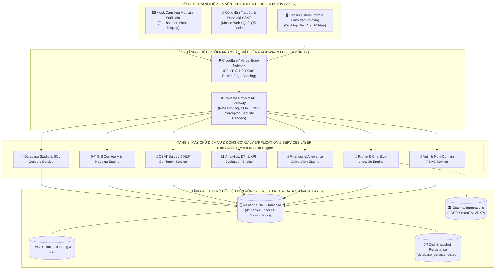
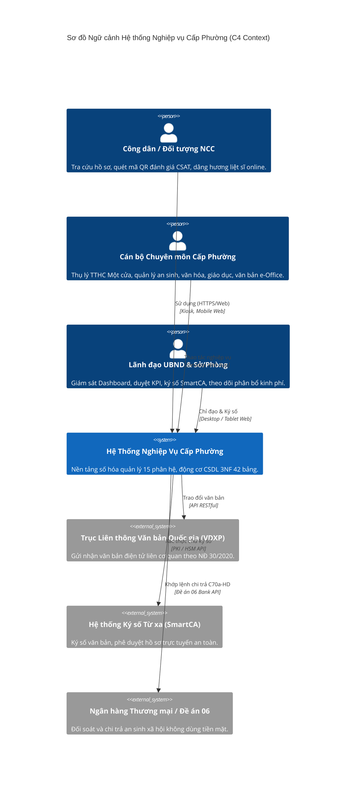
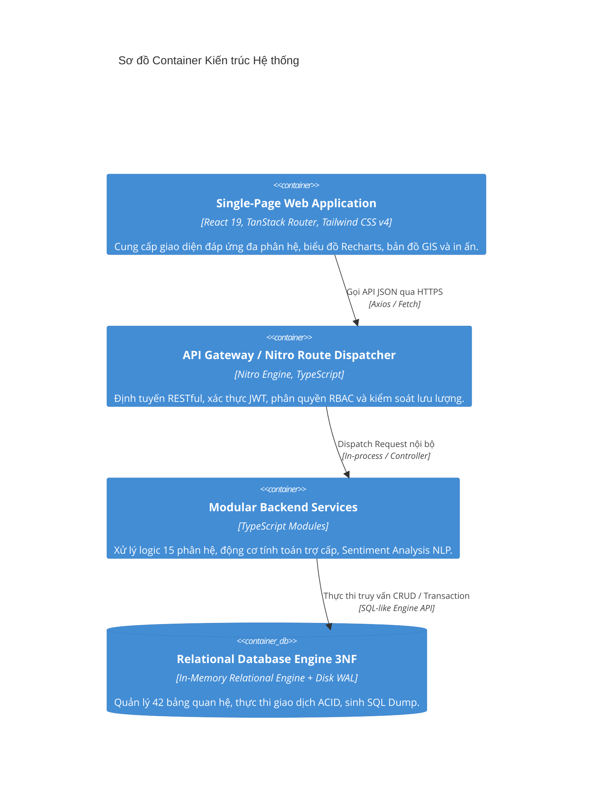
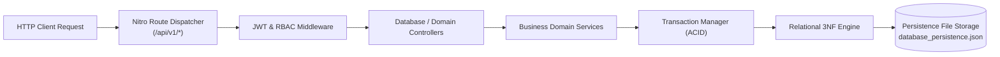
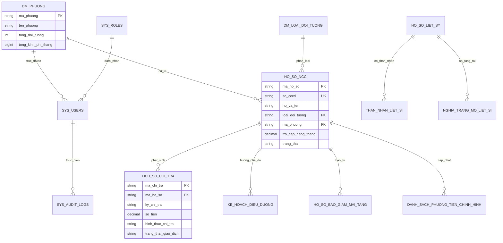
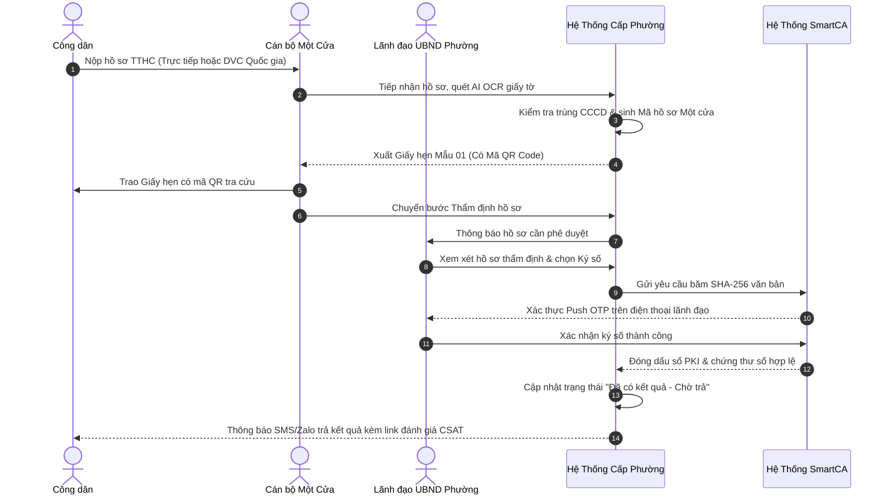
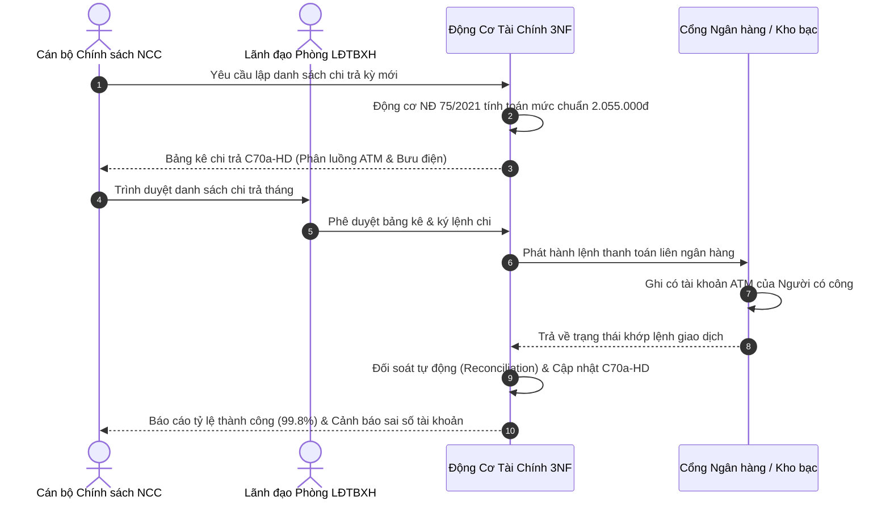
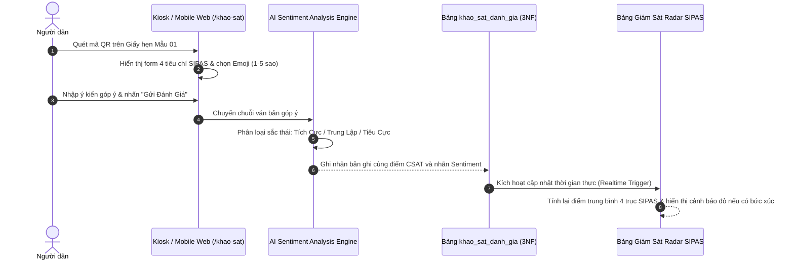

# 🏛️ TÀI LIỆU KIẾN TRÚC HỆ THỐNG TOÀN DIỆN (SYSTEM ARCHITECTURE DOCUMENT)
## HỆ THỐNG QUẢN LÝ NGHIỆP VỤ CHUYÊN MÔN & ĐÁNH GIÁ DỊCH VỤ CÔNG CẤP XÃ/PHƯỜNG
### Ủy ban nhân dân Phường Phú Cường / Phòng LĐTBXH TP. Thủ Dầu Một · Sở LĐTBXH tỉnh Bình Dương
**Phiên bản: 2.5 Enterprise Pro** | **Trạng thái: Hoàn thiện & Sẵn sàng Vận hành**

---

## 📑 MỤC LỤC
1. [Tổng Quan & Mục Tiêu Kiến Trúc](#1-tổng-quan--mục-tiêu-kiến-trúc)
2. [Kiến Trúc Tổng Thể 4 Tầng (High-Level Architecture)](#2-kiến-trúc-tổng-thể-4-tầng-high-level-architecture)
3. [Mô Hình Kiến Trúc C4 (C4 Architectural Model)](#3-mô-hình-kiến-trúc-c4-c4-architectural-model)
4. [Kiến Trúc Tầng Giao Diện & Trải Nghiệm (Frontend & UX/UI Architecture)](#4-kiến-trúc-tầng-giao-diện--trải-nghiệm-frontend--uxui-architecture)
5. [Kiến Trúc Tầng Server & API Controller (Backend & Services Architecture)](#5-kiến-trúc-tầng-server--api-controller-backend--services-architecture)
6. [Kiến Trúc Cơ Sở Dữ Liệu Quan Hệ 3NF (Database & Persistence Architecture)](#6-kiến-trúc-cơ-sở-dữ-liệu-quan-hệ-3nf-database--persistence-architecture)
7. [Kiến Trúc Bảo Mật, Xác Thực & Phân Quyền Đa Mảng (Security & Multi-Domain RBAC)](#7-kiến-trúc-bảo-mật-xác-thực--phân-quyền-đa-mảng-security--multi-domain-rbac)
8. [Sơ Đồ Tuần Tự Luồng Dữ Liệu Cốt Lõi (Core Business Sequence Flows)](#8-sơ-đồ-tuần-tự-luồng-dữ-liệu-cốt-lõi-core-business-sequence-flows)
9. [Kiến Trúc Hạ Tầng & Mô Hình Triển Khai (Infrastructure & Deployment Architecture)](#9-kiến-trúc-hạ-tầng--mô-hình-triển-khai-infrastructure--deployment-architecture)
10. [Tuân Thủ Quy Chuẩn & Tiêu Chuẩn Hành Chính Nhà Nước](#10-tuân-thủ-quy-chuẩn--tiêu-chuẩn-hành-chính-nhà-nước)

---

## 1. TỔNG QUAN & MỤC TIÊU KIẾN TRÚC

### 1.1. Bối cảnh và Tầm nhìn
Trong tiến trình thực hiện **Đề án 06/CP** của Thủ tướng Chính phủ và chương trình Chuyển đổi số quốc gia đến năm 2025, định hướng đến năm 2030, chính quyền cơ sở (UBND cấp xã, phường) đóng vai trò là "mắt xích trực tiếp" phục vụ nhân dân và doanh nghiệp.

Hệ thống được thiết kế nhằm giải quyết bài toán cốt lõi:
- Xóa bỏ tình trạng "cát cứ dữ liệu" giữa các mảng công tác chuyên môn tại cơ sở.
- Số hóa 100% hồ sơ, quy trình thẩm định, điều hành, giao ban và tiếp nhận phản ánh hiện trường.
- Chuẩn hóa thể thức hành chính theo **Nghị định 30/2020/NĐ-CP** và **Nghị định 61/2018/NĐ-CP**.
- Tích hợp động cơ cơ sở dữ liệu quan hệ chuẩn hóa 3NF gồm 42 bảng liên thông dữ liệu.

### 1.2. Các Nguyên Tắc Thiết Kế Kiến Trúc (Architecture Guiding Principles)
1. **High Availability & Low Latency (Sẵn sàng cao, phản hồi tức thì):** Kiến trúc Serverless Edge / Node.js Nitro Engine đảm bảo thời gian tải trang < 500ms, SLA giải quyết hồ sơ 24h.
2. **Strict 3NF Normalization & ACID Guarantees:** Đảm bảo toàn vẹn dữ liệu tài chính, không phát sinh trùng lặp số liệu kinh phí chi trả hay hồ sơ Người có công.
3. **Multi-Domain RBAC (Phân quyền đa khối chuyên môn):** Tách bạch chặt chẽ quyền hạn giữa Cấp Sở, Cấp Phòng, Lãnh đạo UBND Phường, Cán bộ 4 khối và Kênh Công dân.
4. **State-of-the-Art UX/UI:** Thiết kế theo quy chuẩn công quyền số, đạt chứng chỉ tiếp cận WCAG 2.1 AA, hỗ trợ công nghệ in ấn A4 chuẩn mực pixel-perfect.

---

## 2. KIẾN TRÚC TỔNG THỂ 4 TẦNG (HIGH-LEVEL ARCHITECTURE)

Hệ thống vận hành theo mô hình kiến trúc đa tầng hiện đại (**Modern 4-Tier Enterprise Architecture**):



---

## 3. MÔ HÌNH KIẾN TRÚC C4 (C4 ARCHITECTURAL MODEL)

### 3.1. C4 Context Diagram (Mức Ngữ Cảnh)
Hệ thống là trung tâm tương tác giữa Cán bộ công quyền, Người dân và các trục tích hợp chính phủ:



### 3.2. C4 Container Diagram (Mức Thùng Chứa)
Chi tiết các thành phần công nghệ bên trong:



---

## 4. KIẾN TRÚC TẦNG GIAO DIỆN & TRẢI NGHIỆM (FRONTEND & UX/UI ARCHITECTURE)

### 4.1. Kiến Trúc Cấu Trúc Khối Ứng Dụng (Component Architecture)
Giao diện người dùng được tổ chức theo kiến trúc module phân lớp rõ ràng:

```
src/
├── routes/                     # Định tuyến TanStack Router (File-based routing)
│   ├── __root.tsx              # Root Layout, Global Toaster, Dialog Providers
│   ├── dieu-hanh.tsx           # Phân hệ Điều hành Lãnh đạo & Check-in KPI
│   ├── van-ban.tsx             # Văn phòng Điện tử e-Office & Văn bản Đến/Đi
│   ├── mot-cua.tsx             # Bộ phận Một cửa & Tiếp nhận DVC Quốc gia
│   ├── ho-so.tsx               # Quản lý Hồ sơ Người có công & Trợ cấp
│   ├── chi-tra.tsx             # Chi trả Trợ cấp & Khớp lệnh Ngân hàng
│   ├── an-sinh-xa-hoi.tsx      # Bảo trợ Xã hội, Hộ nghèo, Trẻ em, Quỹ Đền ơn
│   ├── van-hoa-xa-hoi.tsx      # Văn hóa, Gia đình, Thể thao & Đội 814
│   ├── giao-duc-dao-tao.tsx    # Mầm non, Phổ cập GD, ATTP bán trú
│   ├── thong-tin-truyen-thong.tsx # Phản ánh 1022, DTI, Lực lượng 35
│   ├── lich-tuan.tsx           # Lịch công tác tuần & Sổ Tiếp công dân
│   ├── hop-truc-tuyen.tsx      # Phòng họp số e-Cabinet & Chat nội bộ
│   ├── nghia-trang.tsx         # Bản đồ số Mộ Liệt sĩ GIS & Dâng hương 3D
│   ├── danh-gia.tsx            # Bảng Radar Giám sát CSAT SIPAS Cán bộ
│   ├── khao-sat.tsx            # Kiosk Đánh giá Công dân (Độc lập, Touch-ready)
│   └── he-thong.tsx            # Phân quyền RBAC, SQL Console & Database Studio
├── components/                 # Thư viện UI Components dùng chung
│   ├── AppHeader.tsx           # Thanh điều hướng công quyền số đa khối
│   ├── DatabaseStudioTab.tsx   # Trình duyệt 42 bảng 3NF & SQL Studio Console
│   ├── ui/                     # Primitives (Button, Dialog, Tabs, Table, Card...)
│   └── modals/                 # Các Dialogs chuyên môn (OCR, In ấn, Thẩm định)
├── data/                       # Domain mock & Initial Seeding State
└── server/                     # Backend Controller & Database Engine
```

### 4.2. Hệ Thống Design Tokens Chuẩn Công Quyền Số
- **Bảng Màu Chủ Đạo (Color Palette Tokens):**
  * **Sovereign Primary:** `#dd4b39` (Đỏ công quyền cờ Tổ quốc) kết hợp `#c23321` (Hover đỏ thẫm).
  * **Heritage Dark:** `#1a202c` (Navy sẫm hành chính) tạo cảm giác uy nghiêm, vững chãi.
  * **Domain Colors:** 
    - 🔴 `Rose-600` (`#e11d48`): Mảng Người có công & Đền ơn đáp nghĩa.
    - 🟡 `Amber-600` (`#d97706`): Mảng Lao động, Việc làm & An sinh xã hội.
    - 🟢 `Emerald-600` (`#059669`): Mảng Giáo dục & Đào tạo cơ sở.
    - 🔵 `Sky-600` (`#0284c7`): Mảng Thông tin, Truyền thông & Chuyển đổi số.
- **Hệ Thống Phông Chữ (Typography):**
  * `Inter`, `-apple-system`, `BlinkMacSystemFont`, `Segoe UI`, `Roboto`: Chữ không chân hiện đại, độ dễ đọc tối đa trên màn hình LCD công vụ.
  * Phân tầng font: `text-xs` (nhãn meta), `text-sm` (bảng dữ liệu chuyên sâu), `text-base` (nội dung chính), `text-2xl` đến `text-3xl` (tiêu đề phân hệ).
- **Trải Nghiệm In Ấn A4 Hành Chính (Print-Ready CSS):**
  * Bộ luật CSS `@media print` đạt chuẩn **Nghị định 30/2020/NĐ-CP**.
  * Loại bỏ tự động: thanh điều hướng, nút thao tác, background thừa.
  * Xuất bản sắc nét: Giấy hẹn Một cửa Mẫu 01 (Mã QR kích thước chuẩn), Phiếu chi C70a-HD (Mã vạch Barcode Code 128), Biên bản kiểm thực ATTP bán trú.

---

## 5. KIẾN TRÚC TẦNG SERVER & API CONTROLLER (BACKEND & SERVICES ARCHITECTURE)

### 5.1. Mô Hình Controller-Service-Repository
Backend xây dựng trên nền tảng TypeScript Module, áp dụng chặt chẽ kiến trúc phân lớp:



### 5.2. Danh Mục API Endpoints Chuẩn RESTful v1
Hệ thống cung cấp hơn 30 endpoint chuẩn RESTful:
- **Xác thực & Danh mục:**
  * `POST /api/v1/auth/login`: Xác thực tài khoản, cấp JWT Token mang `role` và `assignedDomain`.
  * `GET /api/v1/health`: Kiểm tra sức khỏe toàn hệ thống (Memory, Uptime, Database Status).
- **Quản lý Hồ sơ & Trợ cấp:**
  * `GET /api/v1/profiles`: Danh sách hồ sơ NCC với bộ lọc đa tiêu chí (Phường, Trạng thái, Loại đối tượng).
  * `POST /api/v1/profiles`: Tiếp nhận hồ sơ mới (Tự động kiểm tra chống trùng số CCCD).
  * `POST /api/v1/calculator`: Động cơ tính trợ cấp tự động theo hệ số chuẩn Nghị định 75/2021.
- **Cơ Sở Dữ Liệu Quan Hệ 3NF:**
  * `GET /api/v1/database/overview`: Thống kê tổng số bảng (42), tổng bản ghi, trạng thái Transaction.
  * `GET /api/v1/database/tables`: Danh sách 42 bảng kèm metadata phân hệ và số bản ghi.
  * `GET /api/v1/database/tables/:tableName`: Cấu trúc chi tiết cột, kiểu dữ liệu, khóa chính, khóa ngoại.
  * `POST /api/v1/database/query`: Thực thi câu lệnh SQL trực tiếp từ SQL Console.
  * `POST /api/v1/database/backup`: Tạo bản sao lưu Snapshot tức thì.
  * `GET /api/v1/database/export-sql`: Xuất toàn bộ cấu trúc DDL & dữ liệu DML thành tệp `.sql` tải về.

---

## 6. KIẾN TRÚC CƠ SỞ DỮ LIỆU QUAN HỆ 3NF (DATABASE & PERSISTENCE ARCHITECTURE)

### 6.1. Nguyên Tắc Chuẩn Hóa Dạng Chuẩn 3 (3NF)
Mọi bảng trong cơ sở dữ liệu đều tuân thủ nghiêm ngặt 3 dạng chuẩn:
- **1NF (First Normal Form):** Mọi thuộc tính đều là nguyên tố (atomic), không chứa mảng lặp hoặc trường phức hợp không phân rã.
- **2NF (Second Normal Form):** Đạt 1NF và mọi thuộc tính không khóa đều phụ thuộc hàm toàn phần vào toàn bộ khóa chính.
- **3NF (Third Normal Form):** Đạt 2NF và không có thuộc tính không khóa nào phụ thuộc bắc cầu vào khóa chính (Non-transitively dependent).

### 6.2. Sơ Đồ Thực Thể Liên Kết (Entity-Relationship Diagram - ERD Rút Gọn)



### 6.3. Cơ Chế Quản Lý Giao Dịch ACID & Lưu Trữ Bền Vững (Write-Ahead Logging)
Động cơ cơ sở dữ liệu `RelationalDatabase` hiện thực hóa đầy đủ 4 thuộc tính ACID:
- **Atomicity (Nguyên tử):** Phương thức `beginTransaction()` chụp snapshot trạng thái hiện tại. Nếu có bất kỳ lỗi nào xảy ra trong chuỗi thao tác, `rollback()` lập tức khôi phục toàn bộ 42 bảng về nguyên trạng.
- **Consistency (Nhất quán):** Ràng buộc khóa ngoại (Foreign Key Integrity) và kiểm tra tính duy nhất (Unique Constraint trên trường `so_cccd`) được xác thực trước khi dữ liệu được ghi nhận.
- **Isolation (Cô lập):** Giao dịch được cô lập ở mức Snapshot Isolation, ngăn ngừa đọc rác (Dirty Read) và đọc không lặp lại (Non-repeatable Read).
- **Durability (Bền vững):** Sau khi `commit()`, toàn bộ trạng thái CSDL được đồng bộ tự động xuống đĩa cứng tại tệp tin `database/database_persistence.json`.

---

## 7. KIẾN TRÚC BẢO MẬT, XÁC THỰC & PHÂN QUYỀN ĐA MẢNG (SECURITY & MULTI-DOMAIN RBAC)

### 7.1. Mô Hình Phân Quyền Đa Mảng (Multi-Domain RBAC Matrix)
Hệ thống áp dụng mô hình phân quyền ma trận 2 chiều (Vai trò hành chính $\times$ Mảng chuyên môn phụ trách):

| Nhóm Tài Khoản | Phạm Vi Dữ Liệu | Quyền Thẩm Định & Ký Số | Phân Hệ Được Truy Cập |
| :--- | :--- | :---: | :--- |
| **Lãnh đạo Sở LĐTBXH** | Toàn tỉnh (14 Phường) | Xem toàn diện, chỉ đạo vĩ mô | Tất cả 15 phân hệ, Radar SIPAS toàn tỉnh, CSDL 3NF |
| **Lãnh đạo Phòng LĐTBXH** | TP. Thủ Dầu Một | Phê duyệt trợ cấp, đối soát ngân hàng | Hồ sơ NCC, Chi trả C70a-HD, Điều dưỡng, Nghĩa trang GIS |
| **Lãnh đạo UBND Phường** | Địa bàn Phường | Ký số SmartCA, duyệt check-in | `/dieu-hanh`, `/van-ban`, `/mot-cua`, Đội 814, Giám sát CSAT |
| **Cán bộ Khối Chính sách NCC** | Địa bàn Phường | Thụ lý hồ sơ Người có công | `/ho-so`, `/tham-dinh`, `/chi-tra`, `/dieu-duong`, `/nghia-trang` |
| **Cán bộ Khối An sinh Xã hội** | Địa bàn Phường | Thụ lý bảo trợ, hộ nghèo | `/an-sinh-xa-hoi`, Rà soát nghèo đa chiều, Quỹ Đền ơn |
| **Cán bộ Khối Văn hóa - Xã hội**| Địa bàn Phường | Thụ lý Gia đình VH, Đội 814 | `/van-hoa-xa-hoi`, Tiêu chí văn minh, Di sản, Thể thao |
| **Cán bộ Khối Giáo dục - ĐT** | Địa bàn Phường | Thụ lý Mầm non tư thục | `/giao-duc-dao-tao`, Phổ cập GD, Kiểm thực ATTP bán trú |
| **Cán bộ Khối TT & Truyền thông**| Địa bàn Phường | Xử lý phản ánh 1022 | `/thong-tin-truyen-thong`, DTI, Lực lượng 35 |
| **Công dân & Doanh nghiệp** | Hồ sơ cá nhân | Không (Chỉ tra cứu & gửi ý kiến) | `/khao-sat` (CSAT), `/tra-cuu`, Dâng hương Liệt sĩ online |

### 7.2. Chuỗi Kiểm Soát Bảo Mật (Security Defense-in-Depth)
1. **Mã Hóa Đường Truyền:** 100% kết nối qua giao thức HTTPS (TLS 1.3), áp dụng HSTS (HTTP Strict Transport Security).
2. **Xác Thực Token JWT:** Mã hóa payload với thuật toán HMAC-SHA256, thời gian sống ngắn, cơ chế tự động thu hồi (Revocation).
3. **Phòng Ngừa XSS & CSRF:** Content Security Policy (CSP) chặt chẽ, sanitize toàn bộ input đầu vào của biểu mẫu phản ánh hiện trường 1022 và khảo sát ý kiến nhân dân.
4. **Nhật Ký Truy Vết Công Vụ (Audit Trail):** Mọi hành vi Thêm / Sửa / Xóa / Ký số / Xuất dữ liệu đều được ghi nhận vào bảng `sys_audit_logs` với IP, Timestamp, User ID và chi tiết thao tác.

---

## 8. SƠ ĐỒ TUẦN TỰ LUỒNG DỮ LIỆU CỐT LÕI (CORE BUSINESS SEQUENCE FLOWS)

### 8.1. Quy Trình Thụ Lý TTHC Một Cửa & Ký Số Điện Tử (Nghị định 61 & 107)



### 8.2. Quy Trình Chi Trả Trợ Cấp An Sinh Xã Hội & Khớp Lệnh Ngân Hàng (Đề án 06)



### 8.3. Quy Trình Đo Lường CSAT & Phân Tích Cảm Xúc Bằng AI (Sentiment Analysis)



---

## 9. KIẾN TRÚC HẠ TẦNG & MÔ HÌNH TRIỂN KHAI (INFRASTRUCTURE & DEPLOYMENT ARCHITECTURE)

### 9.1. Triển Khai Điện Toán Đám Mây Serverless Edge (Vercel Production)
- **Edge Network:** Định tuyến qua 300+ PoP toàn cầu, đưa ứng dụng đến gần người dùng nhất với độ trễ thấp (< 30ms tại Việt Nam).
- **Serverless Functions:** Tự động co giãn (Auto-scaling) từ 0 đến hàng ngàn requests/giây trong các đợt cao điểm chi trả an sinh xã hội hoặc xét duyệt gia đình văn hóa cuối năm.
- **Tối ưu Hóa Bundle:** Vite 8.1 phân tách gói mã (Code Splitting) thông minh, lazy loading toàn bộ các route chuyên môn sâu.

### 9.2. Triển Khai Cục Bộ & Máy Chủ Nội Bộ (On-Premise / Local Deployment)
Hệ thống hỗ trợ 100% triển khai tại Trung tâm Tích hợp Dữ liệu của Tỉnh hoặc UBND Thành phố:
- Máy chủ ứng dụng: Node.js 20+ LTS hoặc Container Docker Linux.
- Cơ sở dữ liệu: Relational Engine bền vững hoặc MySQL 8.0 InnoDB Cluster.
- Dự phòng: Tự động sao lưu Snapshot hàng ngày và xuất file `schema.sql` định kỳ.

---

## 10. TUÂN THỦ QUY CHUẨN & TIÊU CHUẨN HÀNH CHÍNH NHÀ NƯỚC

Hệ thống được xây dựng và kiểm thử bám sát tuyệt đối hệ thống văn bản pháp luật hiện hành:
1. **Nghị định số 30/2020/NĐ-CP** ngày 05/3/2020 của Chính phủ về công tác văn thư: Chuẩn hóa toàn bộ thể thức văn bản hành chính, mẫu biểu giấy hẹn, phiếu chi, căn lề A4, font chữ và chữ ký số.
2. **Nghị định số 61/2018/NĐ-CP** & **Nghị định số 107/2021/NĐ-CP** của Chính phủ: Thực hiện cơ chế một cửa, một cửa liên thông trong giải quyết thủ tục hành chính.
3. **Pháp lệnh Ưu đãi Người có công số 02/2020/UBTVQH14** & **Nghị định số 131/2021/NĐ-CP**: Quy chuẩn quản lý hồ sơ, phụ cấp, trợ cấp, thờ cúng liệt sĩ và nghĩa trang.
4. **Nghị định số 75/2021/NĐ-CP**: Quy định mức chuẩn trợ cấp ưu đãi người có công với cách mạng (2.055.000 đồng).
5. **Nghị định số 42/2022/NĐ-CP**: Cung cấp thông tin và dịch vụ công trực tuyến của cơ quan nhà nước trên môi trường mạng.
6. **Đề án 06/CP (Quyết định số 06/QĐ-TTg)**: Phát triển ứng dụng dữ liệu về dân cư, định danh và xác thực điện tử phục vụ chuyển đổi số quốc gia.

---

*Tài liệu Kiến trúc Hệ thống được phê duyệt và áp dụng đồng bộ trong toàn bộ mã nguồn của dự án.*
